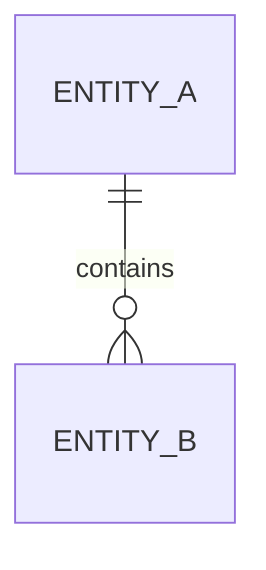

<!--
For non-relational data only. Replace placeholders with project-specific content.
Repeat entity sections as needed, without a fixed count. Add an entity index only if it helps navigation.
Omit optional annotations and empty sections. Keep the ERD focused on relationships, not attributes.
For mixed storage, reference relational definitions in D03-common-data-model.dbml; don't repeat them.
Remove this block and all authoring prompts before writing the output.
-->

# D03 — Common Data Model

[One sentence describing the non-relational data this model covers.]

## Entities

### [Entity name]

[One sentence: purpose and whether this is an entity, value object, or enum.]

**Storage context**: [Only when non-obvious or constraining.]
**Lifecycle**: [States and valid transitions, if relevant.]

| Attribute | Logical Type | Required | Sensitive | Purpose / Handling |
|---|---|---|---|---|
| [Name] | [Type or supporting concept] | [Yes / No] | [Yes / No] | [Meaning and any handling requirements] |

| Related Entity | Cardinality | Relationship |
|---|---|---|
| [Name or link to DBML definition] | [Cardinality] | [Meaning, ownership, or embedding] |

## Entity-Relationship Diagram

## Business Rules

- **[Entity or cross-entity scope]**: [A domain rule, independent of database or framework syntax.]

## Open Questions

- [Question and what would resolve it. Omit this section when none remain.]
